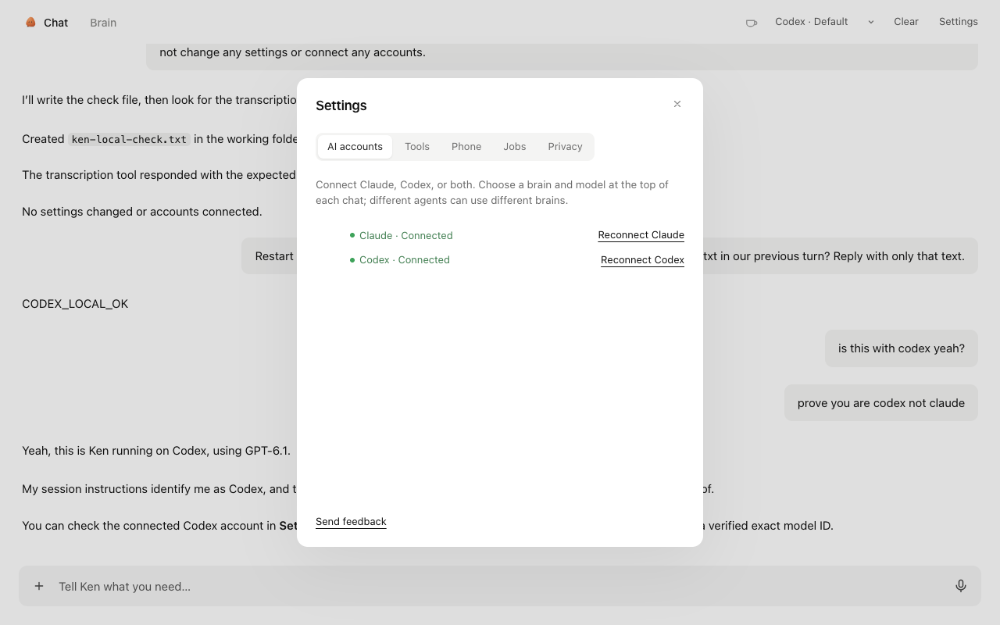

# Ken for Mac

A window onto Ken's engine, `bot.py`: the same engine Telegram uses, owning memory, schedules, voice transcription and (optionally) Telegram, and serving the chat UI from `web/` on `127.0.0.1:7777`. Released builds carry that engine, Python and the Claude CLI inside `Ken.app`, so users install nothing else; in development the app connects to a `bot.py` you run.

The app itself only:

- starts the engine as a background service if it isn't running (and restarts it after an app update)
- signs in with the token in `~/.ken/web-token` (set as a cookie, never in a URL)
- shows the chat, asks macOS for microphone access, keeps a menu-bar icon, and updates itself

First-run setup lives in the engine (`onboarding.py`): Connect Claude runs `claude setup-token`, the same as `install.sh`, and the chat shows voice-model download progress.

Closing the window hides it. Quitting the app leaves the service (and Telegram) running.

## Connecting another Mac

Ken works locally without any server setup. Use **Settings → Computers → Connect a
computer** to use another Mac; once one is saved, a menu below the chat header
switches between it and **This Mac**. Each computer owns its
chats, memory, files, Claude account, tools, and schedules. Switching or quitting
the client does not stop work already accepted by the server.

Server access is optional and off by default. On the Mac that will stay running:

1. Install Ken, connect Claude, and sign into the tools/browser you want it to use.
2. Open **Settings → Computers → Use this Mac as a server** and enable remote connections.
3. Follow **Set up Cloudflare** in Ken. It checks this Mac for `cloudflared`, a running
   process, installed launch services, and local routes pointing at Ken. Choose
   **Use this address** for a detected route, or follow the steps to add a route to
   your existing tunnel. If cloudflared is missing, **Install with Homebrew** installs
   it after you click; without Homebrew, Ken links to installation instructions.
   Sign in to your own Cloudflare account and route a public HTTPS hostname to the
   HTTP service address shown in Ken (normally `http://127.0.0.1:7777`). Keep the
   engine bound to loopback and use a persistent tunnel service. **Test connection**
   checks that the address reaches this Ken instance and opens its live WebSocket.
   See [Cloudflare's setup guide](https://developers.cloudflare.com/tunnel/get-started/).
4. On the client, choose **Connect a computer** and enter the HTTPS hostname and
   server key. Ken checks the connection before saving it.
5. If the hostname is protected by Cloudflare Access, create a service token and
   allow it with a **Service Auth** policy. Expand **My tunnel uses Cloudflare Access**
   on the client and enter both its Client ID and Client Secret. Interactive Access
   login redirects aren't supported. See [service tokens](https://developers.cloudflare.com/cloudflare-one/access-controls/service-credentials/service-tokens/).

Ken does not create or manage Cloudflare accounts, DNS, tunnels, or tunnel tokens.
Account sign-in and route creation happen in Cloudflare's dashboard. Existing
tunnel configurations and services are left intact. Detection checks standard
config locations and paths named by cloudflared launch services; routes managed
only in Cloudflare's dashboard must be entered manually. Installed/running status
is not treated as proof of connectivity. Cloudflare Access credentials supplied
for the server's connection check are used once, not saved. The verified hostname
is remembered; reopening setup requires a new test to show it connected.
The server key is a separate Ken credential. Treat it as access to the server's
files and tools. **Replace server key** disconnects live clients and invalidates the
old key; turning server access off does the same without stopping accepted work.
Connection secrets are stored only in `~/.ken/computers.json`, with owner-only
permissions, and are never included in URLs or computer listings. Remove a saved
connection to delete its credentials from that client. Reconnect with the same
hostname to replace saved credentials.

The server needs power, an awake Mac, internet, and a signed-in user session.
The installed app's LaunchAgent starts after login and keeps running when its
window closes or the app quits. A server reboot stops whatever Ken was doing;
the conversation is kept and Ken doesn't repeat it on its own (agent runs are
marked stopped).
Browser automation uses Chrome on the selected computer. Remote project paths
refer to that computer; attach files to upload them or download results to the
client. Files remain subject to your Cloudflare account's upload/timeout limits.

The page and native controls always load from the local engine. Remote API and
WebSocket requests go through an authenticated local gateway; a remote server
cannot read client connection settings or forward requests to another saved
computer. Views, file URLs, drafts, and voice retries are scoped to a computer.
An unavailable server never falls back to local execution. The client can connect
without a local Claude login, and can remain a client without enabling its server.
Client and server must support the same Ken remote API protocol (currently 1).
For local development and integration tests, HTTP addresses are also accepted
when their hostname is loopback; deployed tunnels should always use HTTPS.

Settings → Appearance offers System (the default), Light and Dark. The choice is
saved on this device, applies immediately, and also themes the desktop loading
screen and native controls. System follows appearance changes while Ken is open.

Telegram and the Mac app share everything: the same conversation, the same `voice.py` transcription, and the same commands. `/model`, `/coffee` and `/decaf` are plain functions in `bot.py` exposed to the chat through `POST /api/command`. `/new` and `/stop` use the chat endpoints.

## Development

To run this checkout alongside an installed Ken:

```sh
uv venv --python 3.12
uv pip install --python .venv/bin/python -r requirements.txt
./dev.sh
# In another terminal:
npm ci
KEN_HOME="$PWD/.context/ken-local" KEN_WEB_PORT=7788 npm run desktop
```

This uses port 7788 and a separate `.context/ken-local` data directory. In the app,
connect **Claude**, **Codex**, or both under **Settings → AI accounts**. Pick a
brain and model at the top of each chat; new agents can choose either at creation.
Different chats and background jobs can use different providers at the same time.
Choices survive restarts and changing a brain does not require restarting Ken.

Codex uses your existing Codex login; if you are signed out, the setup screen opens ChatGPT
sign-in. An `OPENAI_API_KEY` is also supported. Set `KEN_CODEX_HOME` to use a
separate Codex configuration and credential store, or `CODEX_BIN` to override the
SDK's bundled binary with a compatible runtime. `CODEX_MODEL` selects a model;
otherwise Codex uses its configured default. Stop the development engine with Ctrl-C.



For the standard installed Ken home and port:

```sh
ken stop                              # free the port if the installed service is running
.venv/bin/python bot.py               # this repo's service; leave TELEGRAM_BOT_TOKEN unset for app-only
npm ci && npm run desktop
```

Existing installations keep Claude as their initial choice. The earlier
`KEN_BRAIN` setting is migrated once; subsequent choices are saved in the app and
take precedence over the environment. Memory, files and Ken's visible transcript
are shared, while model selections and resumable conversations are stored separately.
On switching a chat's brain, Ken supplies the recent transcript as context. Clear
discards both backends' resume IDs while retaining memory and files.

Codex uses full filesystem access and no execution approval prompts, matching
Ken's Claude configuration. Ken's instructions and existing approval workflow
still govern consequential actions. Codex reuses its user configuration, but
Ken disables inherited MCP servers and enables only the agent's selected servers.
Use `KEN_CODEX_HOME` when you want a separate configuration. Ken's built-in tools
run over stdio MCP; custom tools support stdio and streamable HTTP. Legacy SSE
servers must be changed to one of these transports for Codex.

## Build

```sh
npm run build:engine   # bundles bot.py, Python and the Claude CLI into dist/engine-<arch>
npm run fetch:ffmpeg   # ffmpeg for each Mac into dist/ffmpeg-<arch>, so Ken can make clips
npm run pack           # ad-hoc signed dist/desktop/mac*/Ken.app for local testing
```

The packaged app ships the engine: on first launch it moves itself to Applications if
needed and installs a LaunchAgent (`dev.kencomputer.app`) for the bundled engine. A Ken
home that already has a terminal install (`~/.ken/app/bot.py`) keeps using that instead.

## Releasing

The release checks keep a change from breaking Ken somewhere else:

1. **Locked parts.** `requirements.txt` pins the exact version of every package (generated from `requirements.in`). Dev, terminal installs and release builds all install the same versions.
2. **Every change is tested.** Pull requests and `main` run `tests/check.sh`: the unit tests, plus a check that Ken's native parts load and can decode a voice note.
3. **A tag builds a draft.** `.github/workflows/release.yml` builds the engine on an Apple Silicon and an Intel runner, runs the same native-parts check inside each bundled engine, then signs, notarizes and uploads Ken to a **draft** GitHub Release.
4. **Stable publishing includes a local check.** One command downloads the draft like a user would, checks macOS accepts it, sends a real chat message and a real voice note to its engine, and publishes only if all of that passes:

```sh
git tag v0.1.2 && git push origin v0.1.2      # wait for the release build
desktop/check-release.sh v0.1.2 --publish
```

Every tagged build is installed on a GitHub M-series Mac and made to update itself before it can be published; `check-release.sh` refuses a build whose workflow failed. (Actions → M1 check does the same for any release on request.)

Download files keep fixed names, so `https://github.com/prasann16/kencomputer/releases/latest/download/Ken-arm64.dmg` (and `Ken-x64.dmg`) always point at the newest release. Installed apps download a published release within four hours and install it the next time their window is closed while Ken is idle.

**Manual betas.** In GitHub, choose **Actions → Publish beta → Run workflow**, select **main**, and leave the version blank to use the next beta (for example, `v0.1.22-beta.1`). An optional explicit version must use `vX.Y.Z-beta.N`, target a version newer than the stable tags, and not go backwards from the latest beta. To retry a failed build, enter its exact tag; it must still point to the selected main commit, or rerun the failed release workflow directly.

The workflow waits for that exact main commit's Mac and Windows tests, creates the beta tag, and starts the signed and notarized release build. After both architectures build and the Mac install, self-update and failed-install recovery checks pass, GitHub automatically publishes the prerelease. If a newer version was tagged during the build, the superseded beta stays a draft. Betas do **not** require the local chat-and-voice check. They never become GitHub's latest stable release; the weekly stable path and its local publish check are unchanged.

In Ken, **Settings → Updates on this Mac → Beta · early releases** opts this Mac into beta updates. The choice is saved locally, including when using a remote Ken computer. Stable installs default to Stable; a freshly installed beta defaults to Beta unless a preference was already saved. Older builds without this setting need the first beta downloaded and installed once from [GitHub Releases](https://github.com/prasann16/kencomputer/releases).

Switching back to Stable cancels any pending beta download and clears its install prompt. Ken waits for a stable version newer than the installed version; it never automatically downgrades. Beta users also receive newer stable releases. To run the real chat-and-voice check on a beta yourself, use `desktop/check-release.sh <beta-tag>`; adding `--publish` preserves its prerelease status.

**Weekly update.** `.github/workflows/weekly.yml` runs on Mondays: it moves the locked parts to their newest versions (a newer Claude Code above all), runs the tests, and opens or updates a dependency PR. If nothing changed, it does nothing. After that PR is merged, it waits for the merged commit's Mac and Windows tests, tags the next version, starts the release build, and opens an issue naming the publish command. It never pushes directly to protected `main` or tags an unmerged dependency update.

Enable **Settings → Actions → General → Workflow permissions → Allow GitHub Actions to create and approve pull requests** for the weekly PR. GitHub may ask a maintainer to approve workflow runs on that bot-created PR before its checks start. Publishing still requires the Mac release check above.

Repository secrets the release workflow needs:

| Secret | What |
|---|---|
| `MAC_CERT_P12_BASE64` | Developer ID Application certificate exported as .p12, base64-encoded |
| `MAC_CERT_PASSWORD` | Password of that .p12 |
| `APPLE_API_KEY_P8` | Contents of the App Store Connect API key (.p8) used for notarization |
| `APPLE_API_KEY_ID` | That key's ID |
| `APPLE_API_ISSUER` | The issuer ID shown with App Store Connect API keys |

## Tests

```sh
tests/check.sh
```
