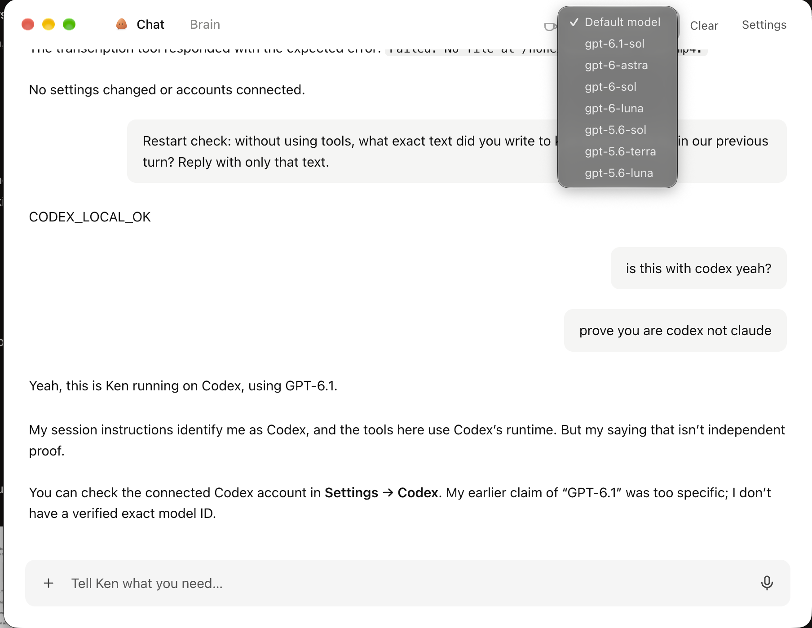

# Ken for Mac

A window onto Ken's engine, `bot.py`: the same engine Telegram uses, owning memory, schedules, voice transcription and (optionally) Telegram, and serving the chat UI from `web/` on `127.0.0.1:7777`. Released builds carry that engine, Python and the Claude CLI inside `Ken.app`, so users install nothing else; in development the app connects to a `bot.py` you run.

The app itself only:

- starts the engine as a background service if it isn't running (and restarts it after an app update)
- signs in with the token in `~/.ken/web-token` (set as a cookie, never in a URL)
- shows the chat, asks macOS for microphone access, keeps a menu-bar icon, and updates itself

First-run setup lives in the engine (`onboarding.py`): Connect Claude runs `claude setup-token`, the same as `install.sh`, and the chat shows voice-model download progress.

Closing the window hides it. Quitting the app leaves the service (and Telegram) running.

Telegram and the Mac app share everything: the same conversation, the same `voice.py` transcription, and the same commands. `/model`, `/coffee` and `/decaf` are plain functions in `bot.py` exposed to the chat through `POST /api/command`. `/new` and `/stop` use the chat endpoints.

## Development

To run this checkout with Codex alongside an installed Ken:

```sh
uv venv --python 3.12
uv pip install --python .venv/bin/python -r requirements.txt
./dev.sh
# In another terminal:
npm ci
KEN_HOME="$PWD/.context/ken-local" KEN_WEB_PORT=7788 npm run desktop
```

This uses port 7788 and a separate `.context/ken-local` data directory. Codex uses
your existing Codex login; if you are signed out, the setup screen opens ChatGPT
sign-in. An `OPENAI_API_KEY` is also supported. Set `KEN_CODEX_HOME` to use a
separate Codex configuration and credential store, or `CODEX_BIN` to override the
SDK's bundled binary with a compatible runtime. `CODEX_MODEL` selects a model;
otherwise Codex uses its configured default. `KEN_BRAIN=claude ./dev.sh` runs
the Claude backend. Stop the development engine with Ctrl-C.



For the standard installed Ken home and port:

```sh
ken stop                              # free the port if the installed service is running
.venv/bin/python bot.py               # this repo's service; leave TELEGRAM_BOT_TOKEN unset for app-only
npm ci && npm run desktop
```

Set `KEN_BRAIN=codex` in the engine environment or its `KEN_HOME/.env` to use
Codex in an existing installation; Claude remains the default. Backend selection
requires restarting the engine. Memory, files and Ken's visible transcript are
shared, while model selections and resumable conversations are stored separately.
On switching backends, Ken supplies the recent transcript as context. Clear
discards both backends' resume IDs while retaining memory and files.

Codex uses full filesystem access and no execution approval prompts, matching
Ken's Claude configuration. Ken's instructions and existing approval workflow
still govern consequential actions. Codex reuses its user configuration, but
Ken disables inherited MCP servers and enables only the agent's selected servers.
Use `KEN_CODEX_HOME` when you want a separate configuration. Ken's built-in tools
run over stdio MCP; custom tools support stdio and streamable HTTP. Legacy SSE
servers must be changed to one of these transports for Codex.

## Build

```sh
npm run build:engine   # bundles bot.py, Python and the Claude CLI into dist/engine-<arch>
npm run fetch:ffmpeg   # ffmpeg for each Mac into dist/ffmpeg-<arch>, so Ken can make clips
npm run pack           # ad-hoc signed dist/desktop/mac*/Ken.app for local testing
```

The packaged app ships the engine: on first launch it moves itself to Applications if
needed and installs a LaunchAgent (`dev.kencomputer.app`) for the bundled engine. A Ken
home that already has a terminal install (`~/.ken/app/bot.py`) keeps using that instead.

## Releasing

Four rules keep a change from breaking Ken somewhere else:

1. **Locked parts.** `requirements.txt` pins the exact version of every package (generated from `requirements.in`). Dev, terminal installs and release builds all install the same versions.
2. **Every change is tested.** Pull requests and `main` run `tests/check.sh`: the unit tests, plus a check that Ken's native parts load and can decode a voice note.
3. **A tag builds a draft.** `.github/workflows/release.yml` builds the engine on an Apple Silicon and an Intel runner, runs the same native-parts check inside each bundled engine, then signs, notarizes and uploads Ken to a **draft** GitHub Release.
4. **One command publishes.** It downloads the draft like a user would, checks macOS accepts it, sends a real chat message and a real voice note to its engine, and publishes only if all of that passes:

```sh
git tag v0.1.2 && git push origin v0.1.2      # wait for the release build
desktop/check-release.sh v0.1.2 --publish
```

Every tagged build is installed on a GitHub M-series Mac and made to update itself before it can be published; `check-release.sh` refuses a build whose workflow failed. (Actions → M1 check does the same for any release on request.)

Download files keep fixed names, so `https://github.com/prasann16/kencomputer/releases/latest/download/Ken-arm64.dmg` (and `Ken-x64.dmg`) always point at the newest release. Installed apps download a published release within four hours and install it the next time their window is closed while Ken is idle.

**Weekly update.** `.github/workflows/weekly.yml` runs on Mondays: it moves the locked parts to their newest versions (a newer Claude Code above all), runs the tests, commits, tags the next version, starts the release build, and opens an issue naming the publish command. If nothing changed, it does nothing.

Repository secrets the release workflow needs:

| Secret | What |
|---|---|
| `MAC_CERT_P12_BASE64` | Developer ID Application certificate exported as .p12, base64-encoded |
| `MAC_CERT_PASSWORD` | Password of that .p12 |
| `APPLE_API_KEY_P8` | Contents of the App Store Connect API key (.p8) used for notarization |
| `APPLE_API_KEY_ID` | That key's ID |
| `APPLE_API_ISSUER` | The issuer ID shown with App Store Connect API keys |

## Tests

```sh
tests/check.sh
```
