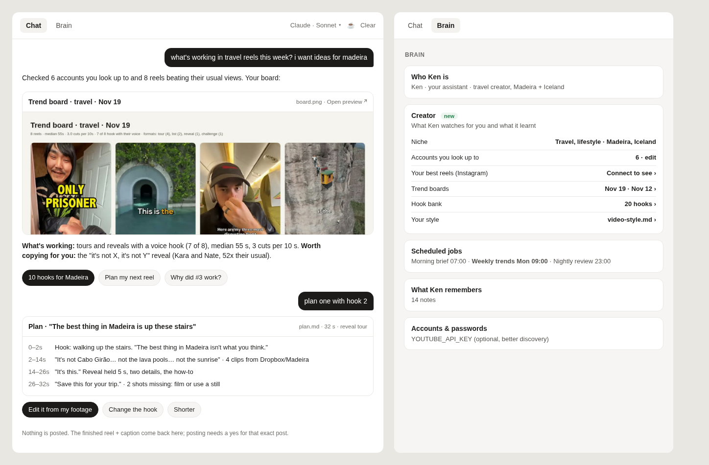

# What's working → the creator's next reel

Research, design and v1 for helping creators (travel and lifestyle first) find what's working and make content
from it. The v1 is a skill: `skills/viral-content` (SKILL.md + `viral.py`). Research date: Nov 19 2026.



## 1. Where the data comes from

| Source | What it gives | Auth | Limits | ToS risk | v1? |
|---|---|---|---|---|---|
| Links/files the creator sends | The reel itself + public counts | none | n/a | low (one fetch, to study, not republished) | **yes, first** |
| YouTube channels they look up to (public pages via yt-dlp, or Data API) | Every recent Short + views → outlier vs the channel's median | none / API key | API: `search.list` 100 calls/day, `videos.list` 1 unit of 10k [1][2] | API: 30-day storage, no derived metrics across channels without audit [3]; pages: scraping, prototype only | **yes** |
| IG Business Discovery | Another business/creator account's media with `like_count`, `comments_count`, `view_count` [4][5] | Facebook Login + `instagram_basic`, `instagram_manage_insights`, `pages_read_engagement`, App Review [6] | 200 × users per hour [7] | low | **yes, once the Instagram connection supports it** |
| IG Hashtag Search | Top/recent media for a tag; **no views, no username** [8] | Public Content Access review [9] | 30 hashtags per 7 days per account [9]; `top_media` gets Reels, 200 results from 16 Feb 2027 [8][9] | low | later (weak signal) |
| The creator's own Insights | `views`, `reach`, `saved`, `shares`, `ig_reels_avg_watch_time`, `reels_skip_rate` [10] (`plays` deprecated Apr 2025 [11]) | IG or FB Login + insights scope | 4,800 × impressions per 24 h [7] | low | **yes: what works for *them*** |
| TikTok Display API | The user's own videos with view/like/comment/share counts [12] | Login Kit + `video.list` | unverified | low | later |
| TikTok Creative Center | Trending hashtags, songs, creators, top ads by region and industry | Top few public; the rest needs TikTok One login; JSON endpoints need signed headers (tested Nov 19) | n/a | ToS §3.4 bans scraping [13] | link out only |
| Pinterest Trends | Trending keywords by region (trends.pinterest.com public [14]); API `/v5/trends/keywords/{region}/top/` [15] | API access gated, "not widely available" [16] | 50 results, today only | low | read by hand; apply for API |
| Google Trends | Official API in alpha since Jul 2025, small pilot [17][18]; pytrends archived Apr 2025 | application | n/a | low | read by hand |
| Meta Content Library, TikTok Research API | Full public content | academics/non-profits only [19][20] | n/a | not allowed commercially | **no** |
| Scraping Instagram | Anything public | none | blocks, bans | Meta terms ban automated collection [21]; *Meta v. Bright Data* (2024) favoured logged-out scraping but is one district ruling [22] | **no** |
| Vendors (Apify, Modash, HypeAuditor) | Creator analytics | API key | paid: Apify $0 to $999/mo [23], Modash from $199/mo [24] | vendor's scraping risk passes to you | later, if needed |

**v1 mix (built):** links they send → accounts they look up to (outlier per account) → their own top posts (when
connected) → hashtag pages last. TikTok trends and Pinterest/Google Trends: linked, read by hand, not scraped.

**What the test showed (real data, Nov 19):** public YouTube hashtag pages are mostly reuploads, AI spam and
clips filming strangers ("#madeira" also returns Portuguese woodworking). 0 of the top 9 from #travel/#iceland
were usable. Seed accounts gave 10 of 10 usable reels. So the product asks for "accounts you look up to" first.

## 2. What makes a reel work: the signals

Measured by `viral.py analyze` (ffmpeg, ffprobe, tesseract and faster-whisper when present):

| Signal | How |
|---|---|
| Length, vertical | ffprobe |
| Cuts per 10 s, average shot, first cut, cuts in first 3 s | ffmpeg scene detection (`scene > 0.3`) |
| First 3 s of speech, speech seconds, talking or not | faster-whisper (VAD on) |
| On-screen text (rough) | tesseract on the hook frames |
| Views, likes, comments, sound | yt-dlp metadata |
| **Outlier score** | views ÷ median views of the account's last ~30 Shorts (skipping the newest 3, still collecting views) |
| Hook frames (0, 0.5, 1, 1.5, 2, 3 s) + 12-frame sheet | ffmpeg, for the AI to look at |

Judged by the AI from the frames, transcript and caption (fixed vocabulary in SKILL.md): hook type
(voice / text / visual, and kind: superlative, open loop, POV, question, number, identity), hook text, why it
stops the scroll, format (tour, list, POV skit, reveal, explainer, challenge, talking head, cinematic montage +
text, day in my life, before/after, things nobody tells you), text style, audio, CTA, why it worked, "steal this".

## 3. The flow in Ken

Chat-first, same in the app and Telegram:

```
"what's working in travel?"         "make one like this" + link
            │                                   │
            ▼                                   ▼
  profile? ──no──► ask ONE question: "3-5 accounts you look up to, or reels you wish you'd made"
            │
            ▼
  find (accounts → own posts → hashtags) → fetch → analyze → AI judges each, drops junk
            │
            ▼
  TREND BOARD (board.png in chat) + 3 lines: what's working, the one move to copy, the offer
            │                    │
            ▼                    ▼
  HOOK BANK (10 in her voice)   PLAN MY NEXT REEL: hook → script → shot list (her Dropbox clips) → edit notes → caption
                                       │ her yes
                                       ▼
                         background job: video skill / ffmpeg montage → reel + caption back to her
                                       │ her yes for that exact post
                                       ▼
                                     post (existing posting connection)
  weekly: offer once → "weekly-trends" job, Mon 09:00, new board + 5 hooks
```

**Where it sits in the UI:** nothing new is needed for v1. The board is a picture in the chat (the app previews
images; Telegram gets a photo), plans and hooks are files in the chat's file list, the weekly digest is a normal
job under Brain → Scheduled jobs. **Next:** a "Creator" section in Brain (`About` in `web/app.js`, next to
Skills): niche, accounts watched, boards, hook bank, style note, and a "connect Instagram to see your best
reels" row; and suggestion chips under Ken's reply ("10 hooks", "Plan my next reel"). See the mock above.

## 4. Test run (real public reels)

10 reels from 6 travel accounts plus 2 from hashtag pages, all analysed and judged. Board summary (all 10): median 49 s,
2.2 cuts per 10 s, 8 of 10 hook with the creator's voice, formats: tour (4), POV (2), reveal (2), list (2).
Top outliers: a POV skit product ad (100x+), a one-take POV meme (77x), Drew Binsky's one-prisoner jail (60x),
Kara and Nate's countdown reveal (52x). Outputs: board, 10 hooks for a Madeira/Iceland creator, a full plan
("The best thing in Madeira is up these stairs"). Sample board (the 8 reels from creator accounts): [board-sample.jpg](board-sample.jpg).

## 5. Later

- **Instagram business discovery** through the posting connection: outliers for Instagram accounts she follows
  (view_count is there), and her own Insights (watch time, skip rate) to rank what works for her.
- **Match this example**: measured pace, text style and colour of a reel she likes go
  straight into `memory/video-style.md`, so first drafts start in her style.
- **Montage edits from a shot list**: cut her clips to the plan's timings with the reference's pace (video-kit).
- **UGC and brand pitches**: the POV-skit → product format (100x+ on the board) is the bridge. Find brands
  already paying creators in her niche (ads in TikTok Creative Center / Meta Ad Library), match them to her best
  reels, draft the pitch with her rate card. Drafts only; she sends.

## Sources

1. https://developers.google.com/youtube/v3/determine_quota_cost
2. https://developers.google.com/youtube/v3/revision_history
3. https://developers.google.com/youtube/terms/developer-policies
4. https://developers.facebook.com/docs/instagram-platform/instagram-api-with-facebook-login/business-discovery
5. https://developers.facebook.com/documentation/instagram-platform/reference/instagram-media
6. https://developers.facebook.com/docs/instagram-platform/instagram-graph-api/reference/ig-user/business_discovery
7. https://developers.facebook.com/docs/graph-api/overview/rate-limiting/
8. https://developers.facebook.com/docs/instagram-platform/instagram-graph-api/reference/ig-hashtag/top-media
9. https://developers.facebook.com/docs/instagram-platform/instagram-api-with-facebook-login/hashtag-search
10. https://developers.facebook.com/docs/instagram-platform/reference/instagram-media/insights/
11. https://developers.facebook.com/blog/post/2025/01/21/making-it-easier-to-build-integrations-across-the-instagram-api-and-marketing-api/
12. https://developers.tiktok.com/doc/tiktok-api-v2-video-object
13. https://www.tiktok.com/legal/page/us/terms-of-service/en
14. https://help.pinterest.com/en/business/article/pinterest-trends
15. https://developers.pinterest.com/docs/analytics-and-reports/trends/
16. https://community.pinterest.biz/t/list-trending-keywords-access/2617
17. https://developers.google.com/search/blog/2025/07/trends-api
18. https://www.searchenginejournal.com/google-trends-api-alpha-mueller-confirms-small-pilot-group/554078/
19. https://developers.facebook.com/docs/content-library-and-api/get-access
20. https://developers.tiktok.com/products/research-api
21. https://www.facebook.com/help/instagram/termsofuse
22. https://techcrunch.com/2024/01/24/court-rules-in-favor-of-a-web-scraper-bright-data-which-meta-had-used-and-then-sued
23. https://apify.com/pricing
24. https://www.modash.io/pricing
